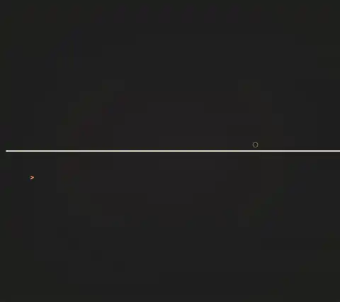
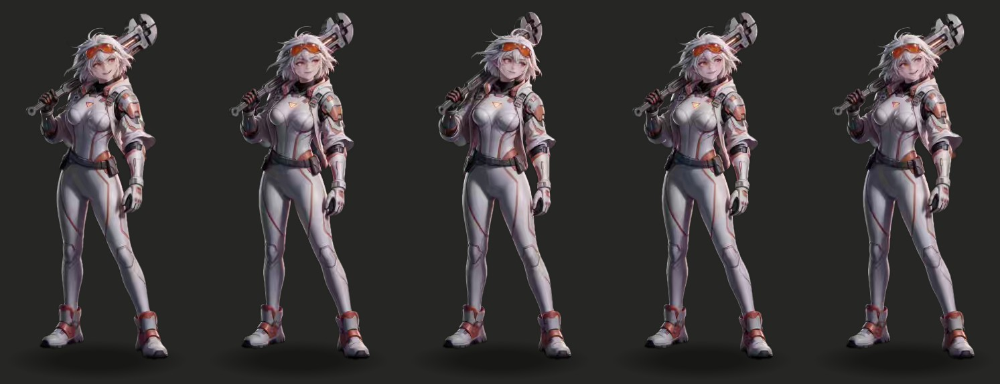
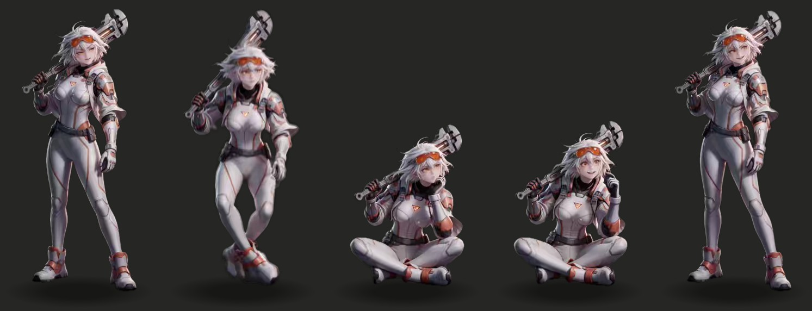
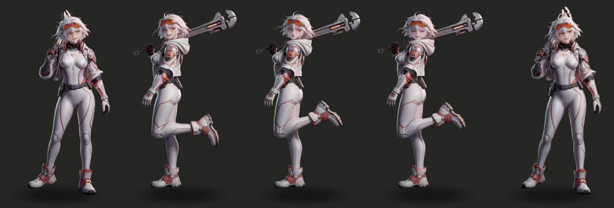
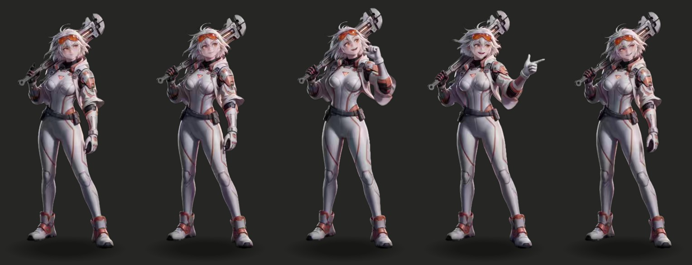
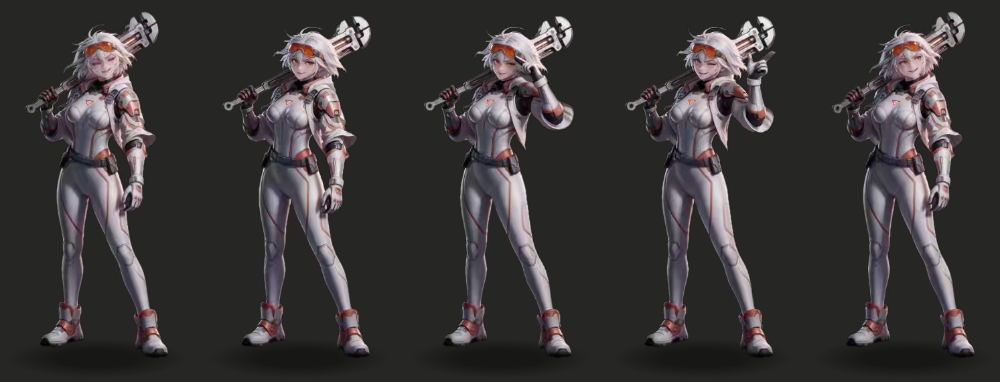
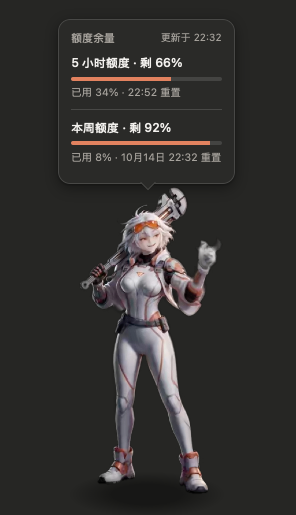

# claude-intro-3d · Claude 桌面版 3D 入场动画

Claude Code 桌面版皮肤 —— 机械师 3D 版（非官方外部插件）。

打开 Claude 桌面 App 时，先在它的窗口上演一段横版动作网游「二次觉醒」式的入场演出：一位 3D 渲染的少女机械师扛着巨型扳手登场，颠一下扳手、拇指抹鼻、竖起大拇指，再转头 wink，同时打出一句欢迎语；约 12 秒后收起，露出已经加载好的主界面；接着她纵身跳出画面，落到左侧边栏，作为桌面宠物陪着你（见下文「侧栏宠物」）。入场只能按 Esc 跳过（右上角有提示），点击或按其他键都不会打断。



> 上面的动图为了控制体积做了降帧（8 帧/秒）、缩小（480 像素宽）和有损压缩，看起来会糊、会有色块；实际播放是 60 帧/秒、按窗口原尺寸渲染。真实画质以下面的截图为准。

### 截图

以下是 App 在 1152×1024 窗口上实际渲染的原尺寸画面（未缩放）：

| 举起扳手 | 竖拇指 | 待机 |
| --- | --- | --- |
|  |  |  |

**[下载 2D 版本 →](https://github.com/YorenZZZ/claude-intro)**（立绘版，约 6.7 秒，体积更小）

## 安装

需要 macOS 14 或更新版本，以及 Xcode 命令行工具（没有的话先运行 `xcode-select --install`）。

```bash
git clone --filter=blob:none --sparse --single-branch https://github.com/YorenZZZ/agent-intro-3d.git
cd agent-intro-3d
./pull.sh claude --install
```

脚本会编译出 `Claude Intro 3D.app`（同时支持 Apple 芯片和 Intel），放进「应用程序」并启动。它没有 Dock 图标，在后台常驻，第一次运行时把自己登记为登录项。之后每次打开 Claude 桌面 App 都会自动播放。

## 使用

- 欢迎语按这台 Mac 的本地时间问候早上好、中午好、下午好、晚上好或夜深了，后面随机接一句台词。
- 不想等 Claude 重启，也可以直接在当前 Claude 窗口上预览一次：

  ```bash
  open -n "/Applications/Claude Intro 3D.app" --args --play
  ```

- 运行记录在 `~/Library/Logs/Claude Intro 3D/app.log`，包括每次检测到 Claude 启动、开始播放的耗时和帧率。

## 侧栏宠物

入场演出结束后，她会落到 Claude 左侧边栏下方，一直待到 Claude 退出。她只在侧栏范围内活动、不抢焦点，只有点在她身上才会响应。下面每张图都是动作片段的原始帧，铺在 Claude 深色侧栏的底色上，脚下是 App 里同样的地面影子。

**待机**：转头、眨眼，头发随动作摆动



**盘腿坐**：坐下托腮想事情，再站起来



**看鞋**：侧过身，抬起后脚看鞋跟



**打响指**



**点她**：回应一个动作，同时弹出额度





- 待机时会随机做一个动作（盘腿坐、看鞋、打响指），两次之间至少隔 25 秒；动作只在头部回到原位的帧上衔接，切换时脸不会跳。
- 点她：做一个回应动作，并弹出 5 小时 / 本周额度气泡；点她以外的任何地方，气泡收起。
- 拖动：按住她可以在**当前侧栏宽度**内随意换位置（侧栏拉宽、拉窄，范围跟着变），位置会记住；入场动画也会落到这个位置。
- 右键菜单：暂时隐藏 1 小时、关闭桌面宠物、查看额度、回到默认位置。
- 拖动或缩放 Claude 窗口、收起侧栏、被别的窗口挡住时，她会先隐藏，停稳后再出现。

### 显示 / 隐藏与额度开关

在 `editions/claude` 目录里运行（或在仓库根目录使用 `./pet.sh claude …`）：

```bash
./pet.sh hide        # 隐藏宠物（入场动画照常播放）
./pet.sh show        # 重新显示（也会结束「暂时隐藏 1 小时」）
./pet.sh quota off   # 点她只做回应动作，不弹额度
./pet.sh quota on    # 恢复点击显示额度（默认）
./pet.sh status      # 查看当前设置
```

改完立刻生效，不用重启 App。

### 额度数据

额度来自仓库里的 Claude Code 插件 [`mod/claude-pet-quota`](mod/README.md)。装上后每轮对话结束会自动更新；点她打开额度时，如果数据已超过 1 分钟，会让一个开着的 Claude Code 会话发一个 1 token 的 Haiku 请求取回最新额度（计入额度，但可以忽略），1 分钟内不管点多少次都不会重复查询。

在仓库根目录安装插件：

```bash
claude plugin marketplace add "$(pwd)/editions/claude/mod"
claude plugin install pet-quota@claude-intro-3d
```

没装插件时，气泡会退回显示 Claude 桌面端自己记录的用量（更新不及时，也没有重置时间）。

## 卸载

在仓库根目录：

```bash
./build.sh claude --uninstall
```

这会把它从登录项里移除、退出后台进程，并把 App 移到废纸篓。装过额度插件的话，再运行 `claude plugin uninstall pet-quota`。

## 工作原理

- 后台小程序监听新启动的 Claude 进程，按 Claude 上次的窗口位置盖上一个无边框浮层；真实窗口出现后贴合它。浮层不抢焦点，Claude 照常在下面加载。
- 横幅、文字、无人机等用 WebKit 渲染，只改变位置、缩放和透明度，全部交给 GPU 合成。
- 人物是一段带透明通道的 HEVC 视频（`Resources/web/layers/awakening.mov`，60 帧/秒）：两段 Seedance 图生视频（耍帅动作＋待机转头）由 `tools/build-clip.py` 抠像、去色偏、插帧后合成，不加投影，衣服上不留暗影，和侧栏宠物一致。人物本身不做任何整体浮动或摆动，所有动作都来自视频。

## 换成你自己的角色

以下命令在 `editions/claude` 目录中运行。

1. 准备一张 3:4 竖版首帧（纯深色背景，人物四周留出足够空白，动作幅度大的部位尤其要留），用图生视频模型生成「动作」一段，再用它的最后一帧生成「待机」一段。提示词要写明镜头完全固定、不推拉环绕。
2. 合成人物视频（需要 Python 3 + numpy / opencv、ffmpeg，以及 macOS Vision 抠像）：

   ```bash
   python3 tools/build-clip.py 动作.mp4 首帧.png --then 待机.mp4 --then-trim 1:140 \
     --core X,Y --hair-zone X0,Y0,X1,Y1 --width 1248
   ```

   `--core` 是胸前发光徽记在首帧里的位置，`--hair-zone` 是只在头部范围里抠掉发丝缝隙背景的区域，`--drop` 可去掉图生视频偶尔出现的叠化鬼影帧。脚本开头的注释有全部参数说明。

   合成后运行 `tools/clip-parts.sh split`：仓库里的所有视频（入场人物约 15MB、起跳、落地和宠物片段）都按约 700KB 分片存放在 `Resources/clip/`（每个附 SHA-256），`build.sh` 构建时自动拼回缺少的视频，测试会检查分片与视频一致。宠物片段由 `tools/build-pet.sh` 按 `tools/pet-clips.json` 合成，起跳和落地由 `tools/build-transition.sh` 生成。
3. 换片后要逐帧量人物最高点、最右伸展和各动作时段，同步 `Resources/web/intro.js` 里的时间轴；总时长写在 `intro.js`、`Sources/main.swift`、`Resources/web/index.html` 三处，测试会检查三者一致。
4. `tools/build-portrait.sh` 从首帧切出静态备用图层，`tools/make-icon.sh` 生成 App 图标，最后重新运行 `./build.sh --install`。

## 开发

以下路径与命令均相对于 `editions/claude` 目录。

| 文件 | 作用 |
| --- | --- |
| `Sources/main.swift` | 后台小程序：监听 Claude 启动、定位窗口、显示浮层、登录项 |
| `Resources/web/intro.js` | 整段动画：横幅、图层、时间轴和问候语 |
| `Resources/web/index.html` | 承载动画的页面和背景遮罩 |
| `Resources/web/layers/` | 人物视频、起跳与落地片段、静态备用人物、标题和无人机图层 |
| `Sources/pet.swift` | 侧栏宠物：跟随 Claude 窗口与实时侧栏宽度、点击与拖动、额度文件 |
| `Resources/web/pet/` | 宠物页面（`pet.js`：动作衔接、气泡）和动作片段 |
| `pet.sh` | 宠物显示 / 隐藏与点击显示额度的开关 |
| `mod/` | 额度插件 `pet-quota`（Claude Code 插件） |
| `art/` | 抠好的人物与无人机原始图层 |
| `Resources/clip/` | 所有视频的分片和 SHA-256（`tools/clip-parts.sh`） |
| `tools/` | 合成人物视频、抠图、烘焙图层、录示范、生成图标的脚本 |
| `build.sh` | 编译、组装、签名、安装和卸载 |
| `tests/` | 问候语、图层引用、时长一致性、视频分片、宠物动作衔接与开关等检查 |

- 测试：`node --test tests/*.test.cjs`；额度插件：`claude plugin test mod/claude-pet-quota`
- `--snapshot <文件夹>` 在屏幕外的模拟窗口上播放并每 0.1 秒存一帧（不接收鼠标、不抢焦点），加 `--size 宽x高` 换窗口尺寸；`--pet-snapshot <文件夹> [间隔秒] --script sit,feet,snap,click --quota sample` 只录宠物。
- 录示范视频：`SIZE=1152x1024 tools/record.sh 输出.mp4`，`SIZE` 填 Claude 窗口的实际尺寸（见 `~/Library/Application Support/Claude/window-state.json`）。

## 素材与声明

- 人物是原创角色，由 AI 生成：定妆图用豆包 Seedream 5.0，动作视频用 Seedance 2.0（均经火山引擎调用），再用 macOS Vision 抠像；不包含任何游戏的官方美术。
- 演出风格是向横版动作网游（如《地下城与勇士》）觉醒技能演出致敬的同人作品，与 Nexon、Neople、Anthropic 均无关联。

## License

[MIT](LICENSE)

---

**English:** A small macOS background app that plays a side-scrolling-action-MMO style "second awakening" cut-in over the Claude desktop app's window while it starts: an original AI-generated 3D mechanic girl (an alpha-channel HEVC clip made from two Seedance image-to-video shots) shoulders a giant wrench, wipes her nose with her thumb, gives a thumbs-up and winks, while a random greeting types out; it folds away after about 12 seconds, revealing the loaded app; only Esc skips it (a hint in the top-right corner says so), clicks and other keys never interrupt. From the repository root, install with `./pull.sh claude --install` (macOS 14+, Xcode Command Line Tools); it opens at login and waits for Claude to launch. Preview with `open -n "/Applications/Claude Intro 3D.app" --args --play`; remove with `./build.sh claude --uninstall`. Afterwards she jumps out and lands in Claude's left sidebar as a desktop pet: random idle poses (sitting cross-legged, checking her heel, a finger snap), a click gets a reaction plus a 5-hour/weekly quota bubble (fed by the `pet-quota` Claude Code plugin in `editions/claude/mod/`, refreshed at the end of every turn and, at most once a minute, on click), and she can be dragged anywhere within the current sidebar width. `./pet.sh claude show|hide` toggles her and `./pet.sh claude quota on|off` the quota bubble. The 2D version lives at [YorenZZZ/claude-intro](https://github.com/YorenZZZ/claude-intro).
